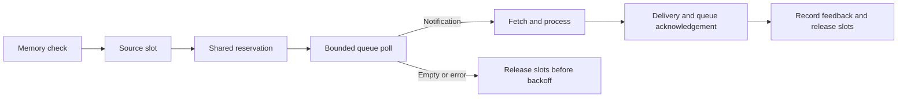

# Adaptive concurrency for blob ingestion

Add opt-in concurrency control inside each Vector process for AWS S3/SQS,
Azure Blob/Storage Queue, and GCS/Pub/Sub. Adjust work in flight using delivery
latency and failures, with explicit source limits and shared memory protection.
The goal is higher useful throughput without choosing one fixed concurrency for
every workload. Throughput improvement remains unmeasured.

Implementation is split into the
[reusable source controller](https://github.com/databricks-eng/vector/pull/843)
and the dependent
[blob-source integration](https://github.com/databricks-eng/vector/pull/841).
Configuration, metrics, and test commands: [implementation notes](adaptive-blob-concurrency.md).

## Problem

A notification points to one or more blob files. Vector fetches the files, decodes
records, sends them downstream, waits for delivery acknowledgement, and acknowledges
the notification. A worker waiting on storage or delivery cannot use the CPU.
More concurrent work can fill those gaps; too much work increases memory use and
downstream pressure.

Fixed worker counts cannot respond to changing object sizes, storage latency, or
sink capacity. Raising every source independently can also exhaust a process that
hosts many queues.

## Design

Reuse Vector's adaptive request-concurrency controller, with independent feedback
for each source. Require end-to-end acknowledgements and one notification per receive.
One notification may contain multiple files, processed sequentially.

There are three independent controls:

| Control | Contract |
| --- | --- |
| Per-source concurrency | Start at `initial_concurrency`; never exceed `client_concurrency`. |
| Shared admission | `max_active_objects` bounds notifications being polled or processed across adaptive sources in one process. |
| Memory guard | Stop new admission at the high watermark; resume below the low watermark. |

Reserve capacity **before receiving a notification**. Waiting for local capacity
must not consume cloud delivery attempts or send healthy messages to a dead-letter
queue. Adaptive sources use short polls with a five-second deadline covering the
complete receive. Empty polls release both slots and wait one second. Disabled-table
draining releases shared capacity before deletion but retains its source slot.

## Feedback loop

Measure processing time from receipt through downstream delivery and cloud
acknowledgement. Exclude polling, admission waits, and byte-rate pacing. Empty polls,
missing objects, invalid notifications, and cancellations do not train successful
latency samples.

At each adjustment window, add one slot when the source has used its current
capacity and latency remains fast relative to its recent history. Reduce concurrency
when latency indicates pressure. Explicit delivery failures clamp the source to one.
Serialize failure feedback with successful completion so stale feedback cannot undo
that clamp.

For example, a source starting at two with a ceiling of eight can grow through
three and four while delivery stays healthy. A ceiling of four still prevents it
from exceeding four, regardless of CPU utilization. The controller does not
automatically choose those ceilings or target a CPU percentage.

Memory protection is separate. Sample the configured cgroup usage at most once
every 250 ms. Use different stop/resume thresholds to avoid oscillation; unreadable
samples block admission. Already reserved work can finish, so this is not a byte
reservation or an OOM guarantee.

## Tradeoffs

- **Latency is an imperfect capacity signal.** Large healthy objects can look like
  congestion. Validate mixed object sizes and slow downstream delivery.
- **Short polling costs more.** Empty responses can occur despite backlog. Pub/Sub's
  `returnImmediately` option is supported but deprecated for performance reasons.
  Many idle queues can also delay busy sources at the shared cap.
- **Normal redelivery remains possible.** A timed-out receive may already have
  leased a message. Existing cloud failure and retry semantics still apply.
- **Replica scaling remains separate.** This controller adjusts work inside a
  process. LJP's current HPA assumes static worker capacity and needs separate
  integration before production rollout.

## Validation and rollout

The feature defaults off. Sources sharing a process must agree on shared limits;
changing those limits requires a process restart.

Local validation passed: 54 focused adaptive tests and a broader suite of
750 passing tests, with one ignored. Coverage includes admission, cancellation,
memory pressure, delivery failures, stalled polls, draining, and feedback races.
These results establish local correctness, not a throughput gain.

Next, compare fixed two, fixed four, and adaptive two-to-four with fixed replicas
and equivalent isolated backlogs. Measure throughput, queue age, CPU, memory,
redeliveries, admission latency, and API request rate. Include idle queues and slow
delivery. Test higher ceilings separately after establishing controller stability.
Reject promotion for sustained regression, oscillation, or unacceptable API cost.
Complete live-cloud validation and HPA integration before production enablement.
